# Assignment Platform Backend — What Is Happening?

This document explains how the backend is put together and why things behaved the way they did when you configured OpenAI.

---

## 1. What you are running

Three pieces work together:

| Piece | Purpose |
|-------|--------|
| **FastAPI** (`uvicorn app.main:app`) | The real backend: ingest PDFs, chunk/embed text, talk to OpenAI, store data in SQLite. |
| **Streamlit** (`ui/streamlit_app.py`) | A **developer dashboard** only. It sends HTTP requests to FastAPI—it does **not** run the PDF or OpenAI logic by itself (except loading `.env` for its sidebar checks). |
| **SQLite DB** (`assignment_platform.db`) | Stored books, chunks, assignments, indexing status. |

If FastAPI is not running, Streamlit buttons will fail with “backend unreachable.”

---

## 2. How API keys (`OPENAI_KEY` / `OPENAI_API_KEY`) are resolved

The code reads your secret **in this order** (defined in [`app/config_env.py`](app/config_env.py)):

1. **`backend/app/.env`** — variables `OPENAI_API_KEY` or `OPENAI_KEY`
2. **`backend/.env`** (repo root), same names
3. **Normal environment variables** (what you exported in the terminal before starting `uvicorn`, or what your IDE injects)

**Important:** **`app/.env` wins over the shell.** Earlier, a short placeholder key (about 11 characters, like something ending in `...`) existed in **the environment**. The old logic looked at the shell **before** the file, so FastAPI kept sending that bad value and OpenAI returned **401**, even though you had pasted a correct long key in `app/.env`.

After the fix:

- Putting a **full** key in `app/.env` as `OPENAI_KEY=sk-…` overrides a bad exported variable.
- A real OpenAI secret is typically **around 150+ characters** on one line, with **no `...`** in the middle.

You can sanity-check **without leaking the full key**:

- `GET http://127.0.0.1:8000/health/config` → `openai_key_diagnostics` (length, whether it looks like a placeholder).
- `GET http://127.0.0.1:8000/health/openai` → runs one embedding + one small chat via **your running API** — if OpenAI accepts the key you see `embeddings_ok` and `chat_ok` both `true`.

---

## 3. Timeline: you upload a PDF — then what?

This is the **same path** whether you use **multipart upload** or **“ingest repo PDF.”** Only the **first hop** differs (file bytes arrive vs path on disk).

```mermaid
flowchart LR
  subgraph ingest [Phase_1_No_AI]
    A[PDF_file] --> B[PyMuPDF_extract]
    B --> C[JSONL_per_page_plus_figure_PNGs]
    C --> D[SQLite_Book_record]
  end
  subgraph index [Phase_2_OpenAI]
    D --> E[Read_JSONL_pages]
    E --> F[LLM_split_each_page_into_chunks]
    F --> G[Embed_each_chunk]
    G --> H[SQLite_Chunk_rows_with_vectors]
  end
  subgraph plan [Phase_3_OpenAI]
    H --> I[Retriever_pick_relevant_chunks]
    I --> J[Planner_LLM_writes_assignment_plan_JSON]
    J --> K[SQLite_Assignment_draft]
  end
```



### Phase 1 — Upload / ingest (**no OpenAI**, no embeddings yet)

**You do:** Call `POST /books/upload` (attach the PDF + title) **or** `POST /books/ingest-repo-pdf` with a path like `fecu1dd/fecu101.pdf`.

**Backend does:**

1. **Writes the PDF to disk** (upload path saves under [`uploads/`](uploads/); repo-ingest reads the PDF where it already is).
2. **Runs textbook extraction** via [`extract_pdf_for_rag.py`](extract_pdf_for_rag.py) / [`extract_pdf_for_rag_run`](extract_pdf_for_rag.py):
   - Opens the PDF with **PyMuPDF**.
   - For each **page**, builds reading order for typical **two-column** layouts.
   - Optional: **clips figure regions** → saves **PNG files** beside the JSON metadata.
   - Writes **one JSON line per page** into something like **`extracted_Data/<pdf_stem>/<stem>_rag.jsonl`** (plus a metadata line).
3. **Saves one `Book` row** in SQLite: title, paths to JSONL and figures folder, page count from metadata, **`index_status` = idle** — there are **no search chunks yet**, only raw page bundles.
4. **Syncs figure metadata** → rows in **`FigureAsset`** (filename, bbox, link to book) so chunks can reference figures later.

**Response you get:** e.g. `book_id`, `status: extracted`, paths to extracted files. Your PDF is **“in the library”** but **not yet searchable**.

---

### Phase 2 — Index (**OpenAI**, creates RAG corpus)

**You do:** `POST /books/{book_id}/index` — optionally `max_pages=3` for a quick test; `background=true` to poll status.

**Backend does:**

1. **Clears previous `Chunk` rows** for this book (re-index replaces chunks).
2. **Loads pages** from the JSONL.
3. **For each page** (respecting `max_pages`):
   - Calls **`gpt-4o-mini`** to propose **semantic splits** (“topics”) for that page’s text → list of `{topic, content}`.
   - Calls **`text-embedding-3-small`** on each chunk’s text → **vector**.
   - Inserts **`Chunk`** rows linked to **`book_id`**, optionally **figure_refs** tied to **`FigureAsset`** ids.
4. **Updates progress** on the same `Book` row (`index_status`, `index_progress`) so GET `/books/{book_id}/index-status` shows “which page”, “how many chunks”.

When done: **`Chunk` rows = what RAG retrieves later.** Until this completes, assignment planning has nothing meaningful to retrieve.

---

### Phase 3 — Assignment plan (**OpenAI**, teacher-facing)

**You do:** `POST /assignments/generate-plan` with `book_id`, learning objectives, and a natural-language **scope** (topic / chapter-ish query).

**Backend does:**

1. **Embeds** your scope query.
2. **Finds nearest chunks** (cosine similarity over stored chunk embeddings — simple version for this codebase).
3. **Calls **`gpt-4o`** with that context + instructor-style instructions → structured **`plan`** + **`prompt_template` / student-facing cues** (depending on payload).
4. **Creates an `Assignment`** row (draft).

**That’s the assignment “design draft”**, not necessarily the finished student-visible assignment UI — it’s what you iterate on later.

---

### One sentence per phase

| After you … | You have … |
|-------------|-------------|
| **Finish Phase 1 (upload)** | Extracted textbook on disk + a **Book** id; figures catalogued. |
| **Finish Phase 2 (index)** | **Chunks + embeddings** in the DB — **RAG-ready**. |
| **Finish Phase 3 (generate plan)** | A **stored assignment draft** built from retrieved chunks + objectives. |

---

## 4. API cheatsheet (same flow as §3)

| Goal | Endpoint |
|------|-----------|
| Upload PDF multipart | `POST /books/upload` |
| PDF already under repo folder | `POST /books/ingest-repo-pdf` |
| Start chunk + embed | `POST /books/{book_id}/index` — try `max_pages`, `background`, `force_restart` query params |
| Watch indexing | `GET /books/{book_id}/index-status` |
| Assignment draft plan | `POST /assignments/generate-plan` |

Details of what each phase does are in **[§3](#3-timeline-you-upload-a-pdf--then-what)**.

---

## 5. Bugs you ran into (in plain English)

| Symptom | Cause |
|---------|--------|
| “Configured” locally but OpenAI **401** | Wrong key picked (short placeholder in **environment** overshadowing `app/.env`). **Fixed** by prioritizing **`app/.env` first.** |
| Background index crashed with **500** | **`JSONResponse`** was accidentally not imported in the books router. **Fixed.** |
| **500** on “generate plan” | The big prompt string used Python `{...}` and broke `.format(...)`. Literal JSON braces **escaped**. **Fixed.** |
| Job stuck **`queued`** | Server error before worker finished — use **`force_restart=true`** once, after fixes. |

---

## 6. Quick commands reference

Start API (from `backend/`):

```bash
uvicorn app.main:app --reload --port 8000
```

Optional UI:

```bash
streamlit run ui/streamlit_app.py
```

One scripted smoke test (API must already be listening):

```bash
python scripts/e2e_fecu101.py
```

Interactive docs:

- Open **http://127.0.0.1:8000/docs**

---

## 7. One-line summary

You have a **FastAPI backend** that (1) **extracts** textbook PDFs to JSONL + figures, (2) **indexes** them with OpenAI chunking + embeddings, (3) **plans** assignments from retrieved chunks plus your instructions. **`app/.env` is now the canonical place for `OPENAI_KEY`**, overriding stray shell values. **`/health/config`** + **`/health/openai`** tell you whether what the server sends to OpenAI is plausible and actually accepted.

If something still fails, read **`book.index_error`** (from polling index status), the API response **`detail`** for that route, or the terminal where **uvicorn** is running—they usually spell out the exact error.
